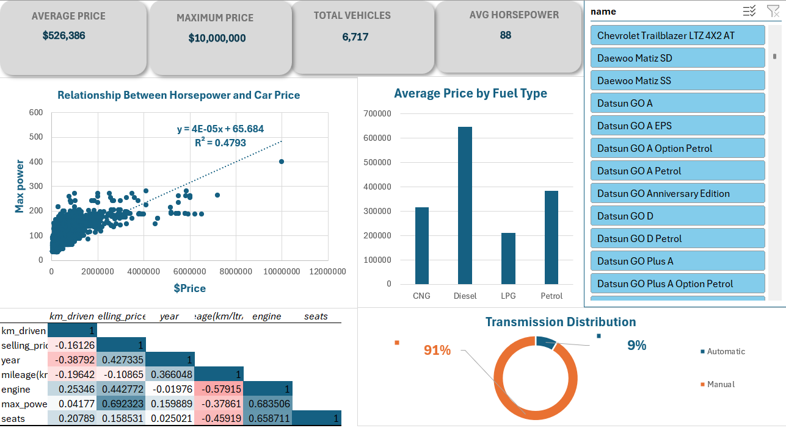

# Used Car Market Analysis — Interactive Excel Dashboard



A statistical analysis dashboard for a used car listing dataset (CarDekho, India), built entirely in **Microsoft Excel**. The project covers the full workflow: loading the raw dataset, cleaning it, computing descriptive statistics and correlations, and presenting the results through an interactive dashboard with KPI cards, five chart types, and a slicer that filters every visual by car model.

---

## Dataset

| Item | Value |
|---|---|
| Source | CarDekho used car listings (publicly released on Kaggle) |
| Raw size | 8,128 records × 12 columns (`data/Project Dataset.csv`) |
| Cleaned size | 6,717 records × 12 columns (used in the dashboard) |
| Model years | 1994 – 2020 |
| Distinct models | 1,982 |
| Listed prices | 29,999 – 10,000,000 (values as provided in the source data) |

### Variables

| Variable | Type | Description |
|---|---|---|
| `name` | Text | Brand, model, and variant of the listed car |
| `year` | Numeric | Manufacturing year |
| `selling_price` | Numeric | Listed selling price |
| `km_driven` | Numeric | Total kilometers driven |
| `fuel` | Categorical | Diesel, Petrol, CNG, or LPG |
| `seller_type` | Categorical | Individual, Dealer, or Trustmark Dealer |
| `transmission` | Categorical | Manual or Automatic |
| `owner` | Categorical | First Owner … Fourth & Above Owner, Test Drive Car |
| `mileage(km/ltr/kg)` | Numeric | Fuel efficiency |
| `engine` | Numeric | Engine displacement (cc) |
| `max_power` | Numeric | Maximum engine power (bhp) |
| `seats` | Numeric | Number of seats |

### Data Preparation

- Checked all 12 columns for missing values — 221 raw records contained missing `mileage`, `engine`, `max_power`, or `seats` values and were removed.
- Removed 1,202 duplicate records.
- Final analytical dataset: **6,717 complete records**, used consistently across every chart and KPI.
- Descriptive statistics and a Pearson correlation matrix were computed for the seven numeric columns.

---

## Dashboard Components

| # | Component | What it shows |
|---|---|---|
| 1 | **KPI Cards** | Average price 526,386 · Maximum price 10,000,000 · Total vehicles 6,717 · Average horsepower 88 bhp |
| 2 | **Scatter Plot + Trendline** | Horsepower vs. price with fitted line `y = 4E-05x + 65.684`, **R² = 0.4793** |
| 3 | **Column Chart** | Average price by fuel type (Diesel, Petrol, CNG, LPG) |
| 4 | **Doughnut Chart** | Transmission split — Manual 91.4% vs. Automatic 8.6% |
| 5 | **Correlation Heatmap** | Pearson correlations among the seven numeric variables |
| 6 | **Slicer (Car Name)** | Filters all KPIs and charts at once for any listed model |

---

## Key Insights

1. **Prices are strongly right-skewed.** The mean price (526,386) sits well above the median (420,000), with a standard deviation of 523,550, skewness of 5.57, and kurtosis of 52.49. Just 49 listings are priced above 3,000,000, and these pull the average upward — the median is the better measure of a typical car.

2. **Horsepower is the strongest single price driver.** Maximum power correlates with selling price at **r = 0.692**, matching the scatter trendline where price alone explains about **47.9%** of the variation in horsepower (R² = 0.4793). The fitted slope implies roughly 1 bhp per additional 25,000 in price.

3. **Diesel cars sit at the top of the price range.** Average price by fuel type: Diesel **647,996**, Petrol **384,051**, CNG **317,667**, LPG **210,886**. Diesel listings (54.5% of the dataset) are concentrated in larger SUVs and sedans, priced about 69% above petrol on average.

4. **The market is overwhelmingly manual.** Manual transmission accounts for **91.4%** of listings (6,142 cars). Automatics are rare (8.6%) but average 1,322,916 — close to three times the manual average of 451,817 — placing them in the premium segment.

5. **Newer cars are driven less and priced higher.** Manufacturing year correlates positively with price (r = 0.427) and negatively with kilometers driven (r = −0.388). Km driven alone has only a weak direct relationship with price (r = −0.161).

6. **Size and efficiency trade off.** Engine size correlates negatively with fuel efficiency (r = −0.579), and seats correlate negatively with mileage (r = −0.459) — larger, multi-seat cars consume more fuel.

### Correlation Matrix (numeric variables)

|  | km_driven | selling_price | year | mileage | engine | max_power | seats |
|---|---|---|---|---|---|---|---|
| **km_driven** | 1 | | | | | | |
| **selling_price** | −0.161 | 1 | | | | | |
| **year** | −0.388 | 0.427 | 1 | | | | |
| **mileage** | −0.196 | −0.109 | 0.366 | 1 | | | |
| **engine** | 0.253 | 0.443 | −0.020 | −0.579 | 1 | | |
| **max_power** | 0.042 | 0.692 | 0.160 | −0.379 | 0.684 | 1 | |
| **seats** | 0.208 | 0.159 | 0.025 | −0.459 | 0.659 | 0.259 | 1 |

### Descriptive Statistics (cleaned dataset)

| Variable | Mean | Median | Std. Dev. | Min | Max |
|---|---|---|---|---|---|
| km_driven | 73,398 | 68,203 | 58,703 | 1 | 2,360,457 |
| selling_price | 526,386 | 420,000 | 523,550 | 29,999 | 10,000,000 |
| year | 2013.61 | 2014 | 3.90 | 1994 | 2020 |
| mileage (km/ltr/kg) | 19.47 | 19.44 | 4.05 | 0 | 42 |
| engine (cc) | 1,430.99 | 1,248 | 493.47 | 624 | 3,604 |
| max_power (bhp) | 87.77 | 81.83 | 31.72 | 32.8 | 400 |
| seats | 5.43 | 5 | 0.98 | 2 | 14 |

---

## Repository Structure

```
.
├── data/
│   └── Project Dataset.csv          # Raw dataset (8,128 records)
├── dashboard/
│   └── Project Data mining(1).xlsx  # Interactive Excel dashboard
├── report/
│   └── Data Mining Dashboard Report.docx  # Written analysis report
├── assets/
│   └── dashboard.png                # Dashboard screenshot
└── README.md
```

## Built With

- Microsoft Excel — dashboard, pivot tables, descriptive statistics, correlation matrix, slicer

---

## Academic Information

| | |
|---|---|
| **Course** | CSC213 — Data Mining and Exploration |
| **Instructor** | Dr. Samia Mohammed Mohammed Abd-Alhalem |
| **Assignment** | Dashboard Design and Data Interpretation |

### Team

| Name | ID |
|---|---|
| Mosab Ahmed Almoghazy | 42510895 |
| Mariam Mahmoud Khalil | 42510361 |
| Mohamed Gamal Suleiman | 42510937 |
| Samira Ali Abdel Ghaffar | 42511156 |
| Mohamed Abdelnaser Maghawry | 42510518 |
| Mariam Ahmed Reda | 42510939 |
| Malak Ahmed Al-Badawi | 42510709 |
| Fatima Amin El-Metwally | 42510356 |
